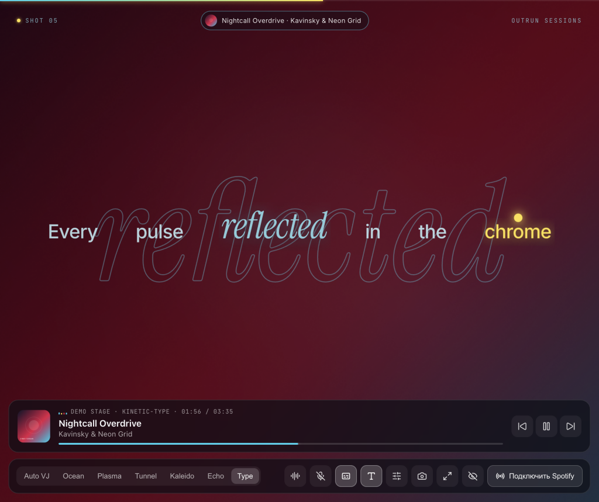
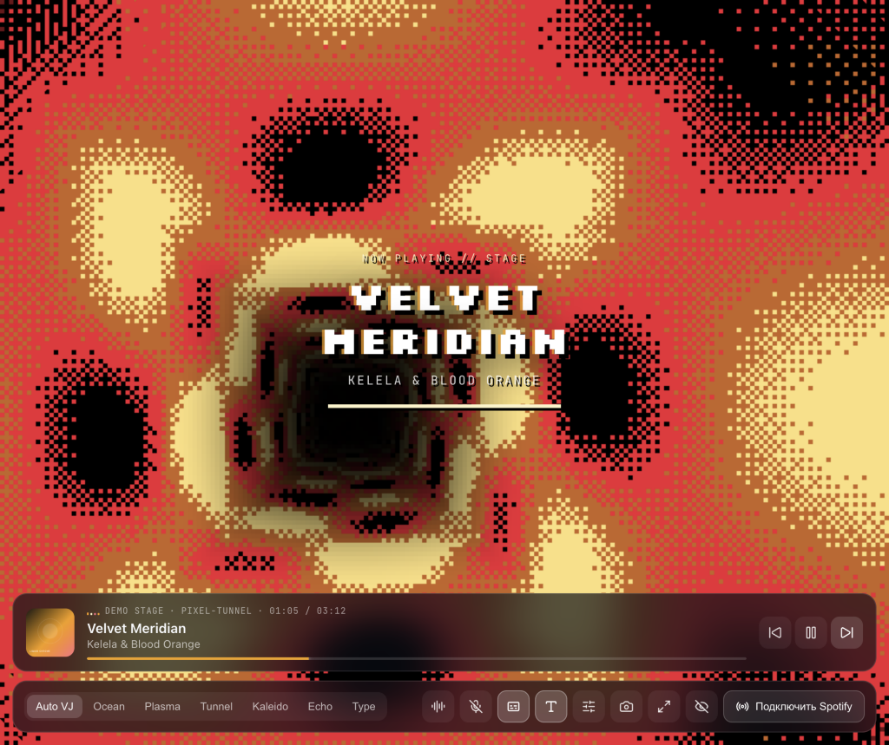
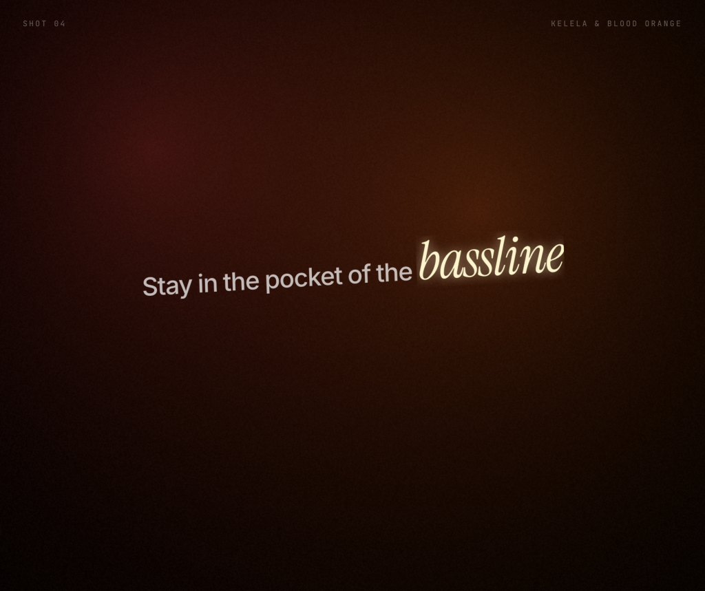

# Spotify Stage

Полноэкранный WebGL-визуализатор для Spotify на второй монитор или телевизор: 8-битные миры с Bayer-дизерингом, типографическая сцена в стиле музыкальных Reels, реакция на живой звук и синхронизированная пословная лирика с параболическим шариком.



## Что внутри

- **6 WebGL-сцен**:
  - `Ocean` — 8-битный закат со сканлайн-солнцем, звёздами, кометами и перспективными волнами.
  - `Plasma` — 8-битная демосцен-плазма с морфингом волн и интерференционных колец.
  - `Tunnel` — варп-туннель с плавной сменой сечения (круг → восьмиугольник → квадрат).
  - `Kaleido` — 8-лучевой пиксельный калейдоскоп в духе *EarthBound*.
  - `Echo` — 8-битный feedback-шлейф в стиле MilkDrop на двойном ping-pong буфере.
  - `Type` — сцена в стиле музыкальных Reels: размытая обложка трека на фоне, 6 монтажных композиций, 3D-переходы камеры (*Fly-Through*, *Whip-Pan*, *Drop*), контурный «призрак» главного слова и фокусировка слов из размытия.
- **Auto VJ и переходы**: автоматическая смена сцен по дропам баса или по таймеру через 8-битный `Bayer Diamond Wipe`, плюс пиксельная ударная волна по клику и на дропах.
- **Палитра из обложки**: цвета сцены, текста и акцентов плавно перетекают под обложку текущего трека (плюс 4 ручных пресета в панели настроек: `Game Boy`, `Sunset`, `Cyber`, `Crimson`).
- **Реакция на реальный звук**: захват чистого звука вкладки/системы (`A`) или микрофона (`M`) с настройкой чувствительности (`Gain 0.5x–2.5x`).
- **Субтитры и 60 FPS шарик**: синхронизированные тексты из [LRCLIB](https://lrclib.net), 3 режима (`Кинетические`, `Скролл на 3 строки`, `Выкл`), переключатель 8-битного/журнального шрифта (`F`) и плавный параболический шарик, приземляющийся на слова ровно в такт.
- **Spotify OAuth PKCE без бэкенда**: работает прямо в браузере, а до подключения аккаунта доступен встроенный Demo-режим.

| 8-битный `Tunnel` + аркадный титр смены трека | Сцена `Type` в 3D-наклоне (`shot-3d-tilt`) |
| :---: | :---: |
|  |  |

## Быстрый запуск

```bash
npm install
npm run dev -- --host 127.0.0.1 --port 5173
```

Откройте в браузере **`http://127.0.0.1:5173/`**.

### Подключение Spotify

1. Создайте приложение в [Spotify Developer Dashboard](https://developer.spotify.com/dashboard) и отметьте **Web API**.
2. В поле **Redirect URIs** добавьте:
   ```text
   http://127.0.0.1:5173/
   ```
3. Нажмите **«Подключить Spotify»** в интерфейсе и вставьте ваш **Client ID**.

## Горячие клавиши

| Клавиша | Действие |
| --- | --- |
| `0` | Режим `Auto VJ` |
| `1`–`6` | Переключение сцен (`Ocean`, `Plasma`, `Tunnel`, `Kaleido`, `Echo`, `Type`) |
| `Space` | Пауза / воспроизведение |
| `A` | Захват звука вкладки / системы |
| `M` | Микрофон |
| `L` | Режим субтитров (`Кинетические` → `Скролл` → `Выкл`) |
| `F` | Переключить 8-битный / журнальный шрифт лирики |
| `G` | Панель палитр, усиления звука (`Gain`) и шарика |
| `S` | Сохранить арт-постер в PNG |
| `H` | Закрепить / скрыть HUD |

## Стек

React 19, TypeScript, Vite, Three.js (кастомные GLSL-шейдеры), Web Audio API, Spotify Web API (OAuth 2.0 PKCE), LRCLIB API.

## Лицензия

[MIT](./LICENSE)
