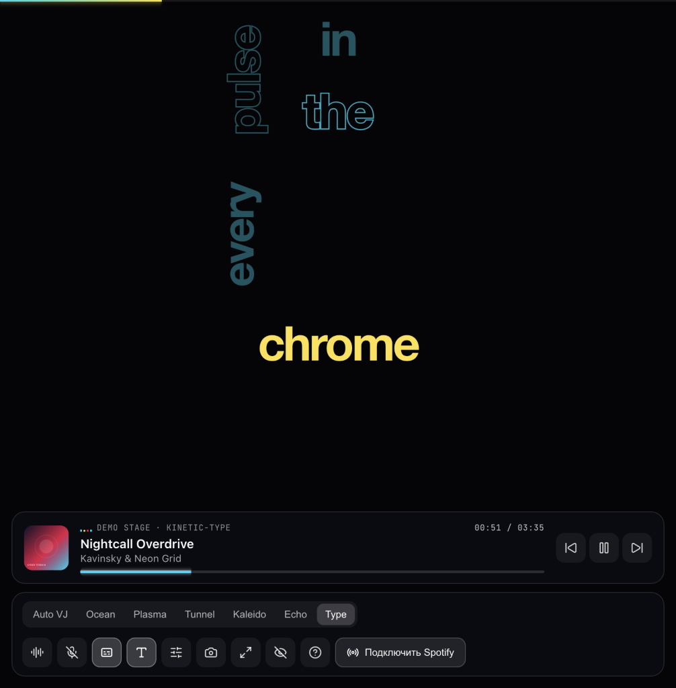
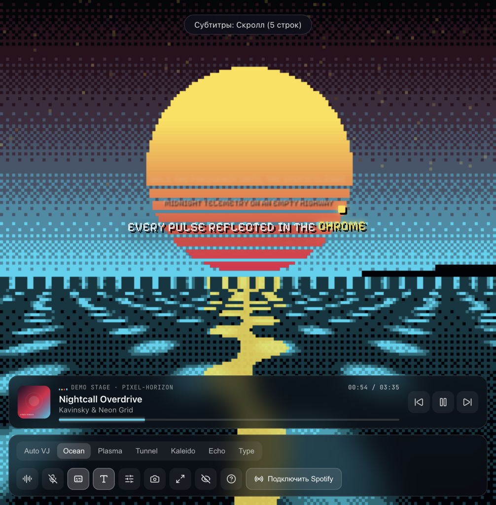
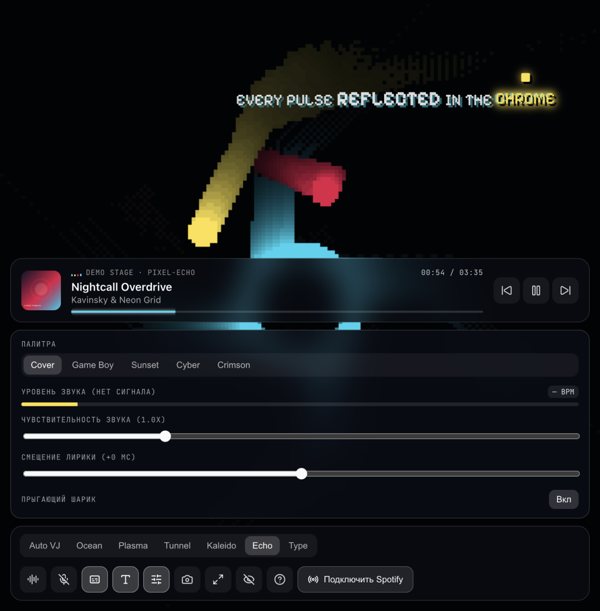

# Spotify Stage

Полноэкранный WebGL-визуализатор для Spotify на второй монитор или телевизор: 8-битные миры с Bayer-дизерингом, кинематографическая типографическая сцена в стиле After Effects Reels, реакция на живой звук с минимальной задержкой и синхронизированная пословная лирика с 60 FPS параболическим шариком.



## Что внутри

- **6 WebGL-сцен (нативный WebGL без Three.js)**:
  - `Ocean` — 8-битный закат со сканлайн-солнцем, звёздами, кометами и перспективными волнами.
  - `Plasma` — 8-битная демосцен-плазма с морфингом волн и интерференционных колец.
  - `Tunnel` — варп-туннель с плавной сменой сечения (круг → восьмиугольник → квадрат).
  - `Kaleido` — 8-лучевой пиксельный калейдоскоп в духе *EarthBound*.
  - `Echo` — 8-битный feedback-шлейф в стиле MilkDrop на двойном ping-pong буфере.
  - `Type` — сцена в стиле After Effects Reels: непрерывная 2D-камера (6 траекторий перелёта, Energy-Driven скорость, Beat Kick, Phrase Pull-Back и повороты `±90°` без наложений), контрастный фон в цвете обложки, связка `Manrope` / контур / `Playfair Display` / `Unbounded`, упругий *Squash & Stretch*, плёночное зерно и пульсирующий круг на проигрышах.
- **Auto VJ и переходы в такт**: автоматическая смена сцен по дропам баса или каждые 32 бита (Auto-BPM трекер) через 8-битный `Bayer Diamond Wipe`, плюс пиксельная ударная волна по клику и на дропах.
- **Палитра из обложки с контролем контраста**: цвета сцены, текста и акцентов плавно перетекают под обложку текущего трека (с защитой читаемости для светлых/тёмных обложек) + 4 ручных пресета (`Game Boy`, `Sunset`, `Cyber`, `Crimson`).
- **Реакция на реальный звук**: захват чистого звука вкладки/системы (`A`) или микрофона (`M`), адаптивный Spectral Flux, авто-нормализация громкости, живой VU-метр и Auto-BPM в панели настроек (`G`).
- **Субтитры, смещение и 60 FPS шарик**:
  - Поиск текстов в [LRCLIB](https://lrclib.net) с поддержкой кириллицы/транслитерации, быстрым фоллбэком `/api/get` без `duration`, таймаутом 5 сек и синтетическим распределением `plainLyrics`.
  - **3 режима субтитров (`L`)**: `Кинетические` → `Скролл (5 строк с глубиной резкости DoF)` → `Выкл` (переключение работает и внутри сцены `Type`).
  - **3 стиля шрифта (`F`)**: `8-bit Pixel` (`Pixelify Sans`, кириллица + латиница), `Editorial` (`Inter` + `Playfair Display Italic`) и вариативный `Brutal` (`Unbounded` с живой жирностью под `--beat`).
  - Настройка смещения лирики (`[` / `]`, ±500 мс под Bluetooth/ТВ) и 60 FPS параболический шарик с жидкой заливкой активного слова.
- **Готово для второго монитора и ТВ**: рендер 8-битных сцен в нативном `1/5` разрешении, плашка «Далее» (Up Next) с предзагрузкой следующего трека из очереди Spotify, перемотка кликом по прогресс-бару, Wake Lock API, OLED-защита на паузе, Media Session API, сохранение настроек в `localStorage` и установка как PWA.
- **Spotify OAuth PKCE без бэкенда**: работает прямо в браузере (с компенсацией сетевой задержки RTT), а до подключения аккаунта доступен встроенный Demo-режим.

| 8-битный `Ocean` + 5-строчный DoF-скролл | `Echo` (feedback-шлейф) + панель настроек (`G`) |
| :---: | :---: |
|  |  |

## Быстрый запуск

```bash
npm install
npm run dev -- --host 127.0.0.1 --port 5173
```

Откройте в браузере **`http://127.0.0.1:5173/`**.

> Проект также автоматически собирается и публикуется на GitHub Pages через `.github/workflows/ci-pages.yml`:
> `https://nightfayer.github.io/spotify-stage/`

### Подключение Spotify

1. Создайте приложение в [Spotify Developer Dashboard](https://developer.spotify.com/dashboard) и отметьте **Web API**.
2. В поле **Redirect URIs** добавьте адрес, с которого открываете сайт (Spotify не принимает `http://localhost`, используйте `127.0.0.1` для локального запуска):
   ```text
   http://127.0.0.1:5173/
   https://nightfayer.github.io/spotify-stage/
   ```
3. Нажмите **«Подключить Spotify»** в интерфейсе и вставьте ваш **Client ID**.

## Проверка и тесты

```bash
npm run lint    # ESLint
npm test        # Unit-тесты (Vitest)
npm run build   # Проверка типов TypeScript и сборка Vite
```

## Горячие клавиши

| Клавиша | Действие |
| --- | --- |
| `0` | Режим `Auto VJ` |
| `1`–`6` | Переключение сцен (`Ocean`, `Plasma`, `Tunnel`, `Kaleido`, `Echo`, `Type`) |
| `Space` | Пауза / воспроизведение |
| `A` | Захват звука вкладки / системы |
| `M` | Микрофон |
| `L` | Режим субтитров (`Кинетические` → `Скролл 5 строк` → `Выкл`) |
| `F` | Переключить шрифт лирики (`Pixel` / `Editorial` / `Brutal`) |
| `[` / `]` | Смещение лирики на −25 / +25 мс (для Bluetooth / ТВ) |
| `G` | Панель палитр, VU-метра, BPM, `Gain`, `Offset` и шарика |
| `S` | Сохранить арт-постер в PNG |
| `H` | Закрепить / скрыть HUD |
| `?` | Показать / скрыть справку по клавишам |

## Стек

React 19, TypeScript, Vite, нативный WebGL (кастомные GLSL-шейдеры), Web Audio API, Spotify Web API (OAuth 2.0 PKCE), LRCLIB API, Vitest, PWA.

## Лицензия

[MIT](./LICENSE)
